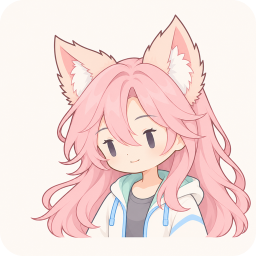

# ASHA

**Aspiring Game Developer**

## Timeline

- **2023** — Enrolled at Hallym University.
- **Sep 2026 – Present** — GVE Lab.

## Tech Stack

| Category | Technologies |
| --- | --- |
| Languages | C# · C · C++ |
| Game Engine | Unity |

## Projects

- **UnityBridgeDesk** — In development. A desktop tool for Unity development automation and AI-assisted workflows.
- **REDLINE 120** — In development. A Unity action roguelite built around a 120-second survival timer.
- **Unity Scene Diff** — Concept. An idea for making Unity scene and prefab changes easier to review.

GitHub Activity

   
  Updated automatically every 6 hours · Public GitHub data only · Last update shown on the card. 
  <a href="https://github.com/gyomoo0424">View current contributions and activity</a>

