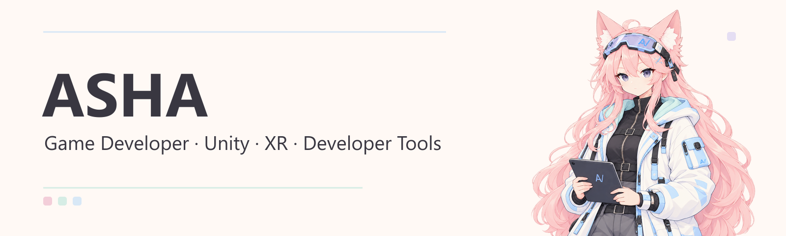
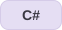
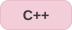
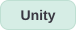
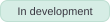
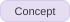
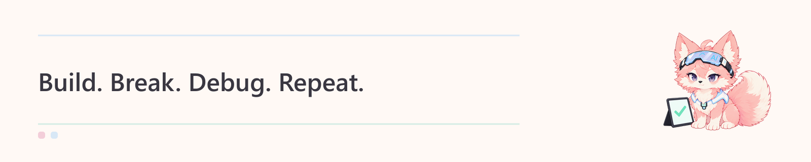

  

## 01. About

<table>
  <tr>
    <td width="840">
      <b>Hi, I'm ASHA.</b> 
      Aspiring game developer. Interested in games and working with Unity.
    </td>
  </tr>
</table>

## 02. Timeline

<table>
  <tr>
    <td width="180"><b>2023</b></td>
    <td width="660"><b>Hallym University</b> Enrolled</td>
  </tr>
  <tr>
    <td><b>Sep 2026 – Present</b></td>
    <td><b>GVE Lab</b></td>
  </tr>
</table>

## 03. Tech Stack

<table>
  <tr>
    <th align="left" width="180">Languages</th>
    <td width="660">
      
      
      
    </td>
  </tr>
  <tr>
    <th align="left">Game Engine</th>
    <td></td>
  </tr>
</table>

## 04. Featured Projects

<table>
  <tr>
    <td width="840">
      <b>UnityBridgeDesk</b> &nbsp;  
      A desktop tool for Unity development automation and AI-assisted workflows.
    </td>
  </tr>
  <tr>
    <td>
      <b>REDLINE 120</b> &nbsp;  
      A Unity action roguelite built around a 120-second survival timer.
    </td>
  </tr>
  <tr>
    <td>
      <b>Unity Scene Diff</b> &nbsp;  
      An idea for making Unity scene and prefab changes easier to review.
    </td>
  </tr>
</table>

## 05. GitHub Activity

   
  Updated automatically every 6 hours · Public GitHub data only. 
  Last update shown on the card · <a href="https://github.com/gyomoo0424">View current contributions and activity</a>

  

