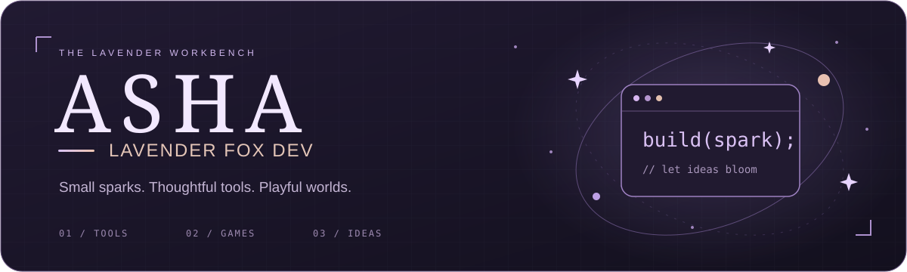
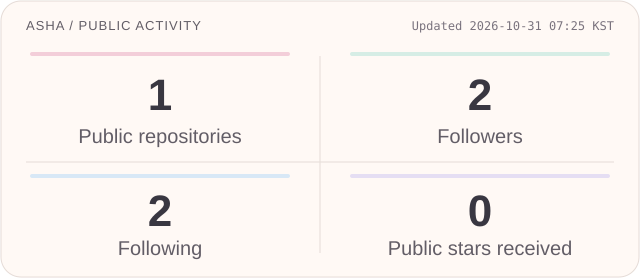

  

  <b>Unity tools · Game prototypes · Ideas in bloom</b> 
  A small lavender corner of the development universe.

  

### ✦ A little about me

Hi, I'm **gyomoo0424**. I build Unity tools and game prototypes, with a soft spot for clear workflows and playful details.

I enjoy turning complicated steps into useful tools, experimenting with gameplay, and giving small ideas room to grow.

### ✦ On my workbench

| Project | What I'm exploring | Stage |
| :--- | :--- | :--- |
| **UnityBridgeDesk** | A Windows desktop workspace for UnityBridge setup, AI-assisted tasks, and version benchmarks. | Private · Windows test build |
| **REDLINE 120** | A Unity gameplay prototype exploring timed arena combat, combos, and risk–reward choices. | Private · Prototype |
| **Unity Scene Diff** | An idea for making Unity scene changes easier to inspect and compare. Scope and implementation are still being explored. | Concept · Not implemented |

UnityBridgeDesk and REDLINE 120 are currently private. Unity Scene Diff is still an idea.

### ✦ Tools I build with

| Focus | Stack |
| :--- | :--- |
| Games & prototypes | **Unity · C#** |
| Desktop tools | **.NET · WPF** |
| Development workflow | **Git · GitHub · PowerShell** |

### ✦ GitHub at a glance

  

  Public profile snapshot · October 30, 2026 · Private repository activity is excluded. 
  <a href="https://github.com/gyomoo0424">Visit my profile for the current contribution graph and activity.</a>

   
  <b>Made of small sparks and steady progress.</b>

